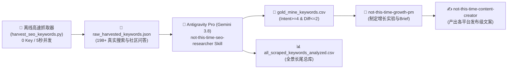

# Not This Time - SEO 黄金长尾词自动化增长矩阵 (路线 C 完整架构)

针对行为干预与自律 App **"Not This Time"**（[App Store](https://apps.apple.com/app/6769012887)），聚焦深夜暴食（Midnight Cravings）、冲动延迟（Urge Surfing）与微阻力心理学。

---

## 路线 C 核心架构（零外部 API Key · 3.8 旗舰大脑联动）



---

## 目录结构

```text
notthistime/
├── .agents/skills/
│   ├── not-this-time-seo-researcher/SKILL.md # 本次新建的 3.8 旗舰 SEO 研究员 Skill
│   ├── not-this-time-growth-pm/SKILL.md      # 已有的 Growth PM 增长规划 Skill
│   └── not-this-time-content-creator/SKILL.md# 已有的全平台文案创作 Skill
└── SEO_agent/
    ├── harvest_seo_keywords.py       # 零依赖极速并发抓取脚本
    ├── raw_harvested_keywords.json   # 抓取的 198+ 原始长尾问题池
    ├── gold_mine_keywords.csv        # 62 个高转化黄金长尾词矩阵
    ├── all_scraped_keywords_analyzed.csv # 198 个全景长尾词库
    └── README.md                     # 本说明文档
```

---

## 日常使用工作流（极简两步）

### 第 1 步：5 秒并发抓取最新长尾池（本地免 Key 执行）
在终端执行：
```bash
python3 /Users/wuhangyan/Documents/claude/notthistime/SEO_agent/harvest_seo_keywords.py
```
*(5 秒内自动从 Google Suggest、Reddit 4 大板块、Quora 捕获近 200 条新鲜真实痛点词)*

### 第 2 步：在 Antigravity 中直接对话触发 Skill
只需在对话框输入：
> *"请调用 not-this-time-seo-researcher 帮我分析最新的长尾词库，挑选出本周最适合写成转化文章的黄金词，并给出切入 Brief。"*

系统将自动使用你 **Antigravity Pro 拥有的 Gemini 3.8 旗舰模型**，直接输出包含心理学深度切入点、App 功能锚点与选题大纲的高维商业策略！
