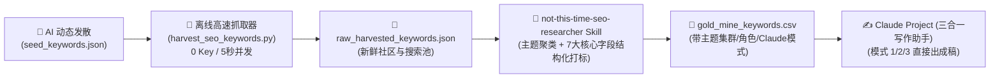

# Not This Time - SEO 黄金长尾词自动化增长矩阵 (v3.2 主题集群增强版)

针对行为干预与自律 App **"Not This Time"**（[App Store](https://apps.apple.com/app/6769012887)），聚焦深夜暴食（Midnight Cravings）、冲动延迟（Urge Surfing）与微阻力心理学。

---

## 路线 C 完整工作流（零外部 API Key · 3.8 旗舰大脑联动）



---

## 核心产出表格：7 大增强字段说明

导出的 [`gold_mine_keywords.csv`](file:///Users/wuhangyan/Documents/claude/notthistime/SEO_agent/gold_mine_keywords.csv) 直接包含以下 7 大全流程字段：

1. **`keyword`**：真实搜索长尾词
2. **`intent_score`**：转化意图分 (1-5)
3. **`seo_difficulty`**：竞争难度分 (1-5)
4. **`topic_cluster`**：归属主题集群（如 `[集群 A] 意志力耗竭与自责`、`[集群 B] Urge Surfing 冲动冲浪`、`[集群 C] 厨房微摩擦与多巴胺`、`[集群 D] 节律失调与晚间破戒`）
5. **`content_role`**：内容角色（`Pillar 核心支柱母篇` 或 `Satellite 卫星子长尾`）
6. **`suggested_claude_mode`**：推荐 Claude 模式（`模式 1: 方法论` / `模式 2: 竞品评测` / `模式 3: 垂直人群`）
7. **`recommended_title`**：爆款英文作战标题建议
8. **`actionable_advice`**：一句话切入角度与 Not This Time App 转化锚点

---

## 日常极简使用方式

1. **抓取最新长尾数据**：
   ```bash
   python3 /Users/wuhangyan/Documents/claude/notthistime/SEO_agent/harvest_seo_keywords.py
   ```
2. **在对话中唤醒 Skill 分析**：
   在 Antigravity 聊天框中输入：
   > *"调用 `not-this-time-seo-researcher`，根据最新抓取结果更新主题集群黄金表格。"*
3. **复制到 Claude Project 写作**：
   打开导出的 `gold_mine_keywords.csv`，挑出你本周要打的集群，直接把关键词和建议标题丢给 Claude Project，秒级产出发布级英文长文！
